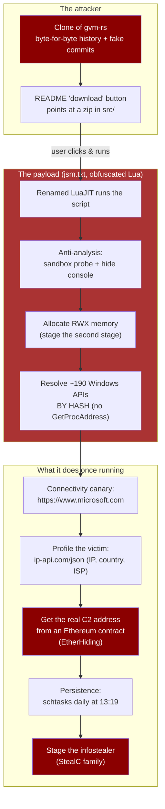
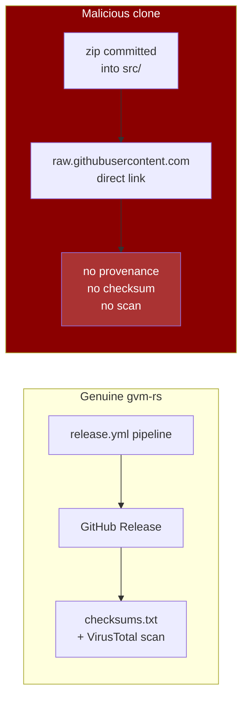
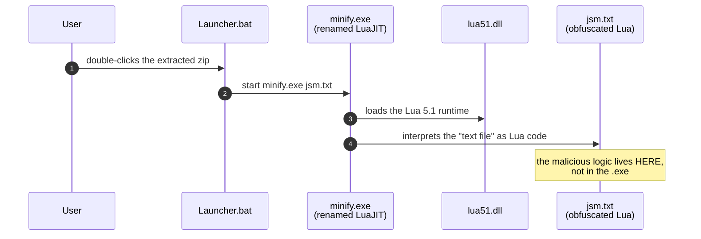
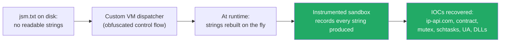
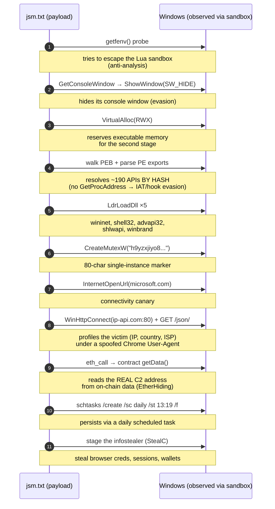
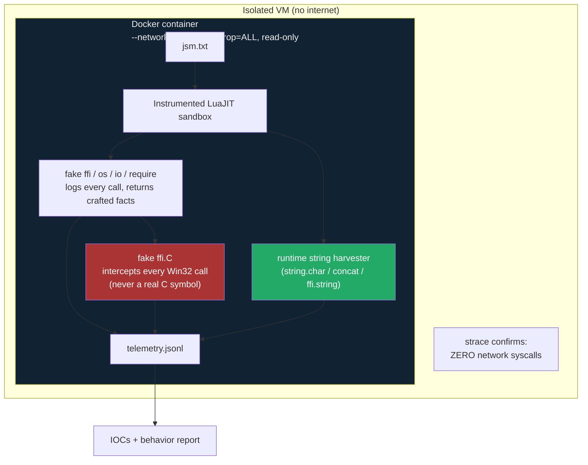

# Anatomy of a Malicious Repository Clone

**A real case study: how an attacker cloned `gvm-rs`, hid a Lua-based infostealer behind fake
commits, and tried to trick users into running it - and how we caught and fully documented it.**

> **TL;DR** - An attacker created `Foremost-headsail607/gvm-rs`, a byte-for-byte copy of this
> project's history, then added a malware chain disguised as ordinary project files. Its README
> "download" button points at a zip containing a **renamed legitimate LuaJIT interpreter** plus an
> **obfuscated Lua script** that profiles the victim, gets its command-and-control address from an
> Ethereum smart contract, installs a daily scheduled task for persistence, and stages an
> infostealer. We detected it with an automated clone-watch, analyzed it **without ever running the
> Windows binary** (using an instrumented LuaJIT sandbox), and recovered its full behavior and
> network indicators. **No user of the genuine `gvm-rs` is affected** - real releases only ever come
> from [GitHub Releases](../../README.md#-installation), never from a zip committed into `src/`.

---

## Table of contents

1. [The attack in one diagram](#1-the-attack-in-one-diagram)
2. [Who is behind it](#2-who-is-behind-it)
3. [What they tried to slip past users](#3-what-they-tried-to-slip-past-users)
4. [The delivery chain: how the malware starts](#4-the-delivery-chain-how-the-malware-starts)
5. [How the malware hides (obfuscation + LOLBIN)](#5-how-the-malware-hides-obfuscation--lolbin)
6. [What the malware actually does, step by step](#6-what-the-malware-actually-does-step-by-step)
7. [The techniques, explained](#7-the-techniques-explained)
8. [Indicators of compromise (IOCs)](#8-indicators-of-compromise-iocs)
9. [How we analyzed it safely](#9-how-we-analyzed-it-safely)
10. [How to protect yourself](#10-how-to-protect-yourself)
11. [How to protect *your* project from the same attack](#11-how-to-protect-your-project-from-the-same-attack)
12. [Status: takedown & platform response](#12-status-takedown--platform-response)
13. [Beyond GitHub: the same threat on other ecosystems](#13-beyond-github-the-same-threat-on-other-ecosystems)
14. [Sources & references](#14-sources--references)

---

## 1. The attack in one diagram

---

## 2. Who is behind it

- **The malicious repository:** [`Foremost-headsail607/gvm-rs`](https://github.com/Foremost-headsail607/gvm-rs)
  (created 2026-06-16). It began as an exact copy of this project's git history, then diverged to add
  the malware chain. It is **not** a fork (GitHub `fork: false`) - it's an impersonation.
- **The campaign context:** this matches a broader 2026 wave of **fake-repository clones** that
  security researchers call **"SmartLoader → StealC"** - over a hundred lookalike repos delivering a
  Lua-based loader that stages the **StealC infostealer**. The naming (`Lua/Agent.CQ`, a Lua-based
  trojan family, per ESET) and the delivery mechanism line up exactly.
- **Attribution limits:** we can describe *what* they did and *how*, with high confidence, but not
  *who they are* as individuals - that requires platform-level data only GitHub holds. This is one
  reason a complete abuse report (with behavioral evidence, which the first report lacked) matters.
- **What happened when we reported it:** the first report (2026-07-20, Ticket ID `4587510`) included
  file hashes, VirusTotal results, and a full commit-history reconstruction. The reply, received the
  next day on the same ticket, didn't mention the reported repository, the malware, or any of the
  evidence at all - it addressed an unrelated Copilot-access restriction. See
  [§D of the incident report](incidents/2026-06-malicious-clone-foremost-headsail607.md#d-githubs-response-to-the-first-report)
  for the full exchange. This is why the 2026-08-22 dynamic analysis was filed as a new report
  rather than a reply on that thread.

---

## 3. What they tried to slip past users

The trap is **social engineering layered on top of a technical chain**. A user lands on a repo that
*looks* like the real `gvm-rs` - same name, same README, same history. The only difference: the
"download" button doesn't go to a signed, checksummed GitHub Release (how the real project ships).
It points at a **zip file committed directly into the source tree**.

Inside that zip are four files. Their SHA-256 hashes match the artifacts first seen in the repo's
June commit history - confirming this is the *same* known payload, still actively distributed:

| File | Size | What it claims to be | What it actually is |
|---|---|---|---|
| `Launcher.bat` | 24 B | a launcher | one line: `start minify.exe jsm.txt` |
| `minify.exe` | 31,920 B | a "minifier" tool | a **genuine, renamed LuaJIT 2.1 interpreter** (a LOLBIN) |
| `lua51.dll` | 601,461 B | a runtime DLL | the real Lua 5.1 runtime |
| `jsm.txt` | 327,648 B | a text file | **the malware**: heavily obfuscated Lua source |

---

## 4. The delivery chain: how the malware starts

The chain is deliberately built so that **no single file looks malicious on its own**:

**Why this defeats naive antivirus:** `minify.exe` is byte-for-byte a stock, trusted LuaJIT build -
its PE imports are only `lua51.dll` + the C runtime, no networking or injection APIs. A signature
that looks at the `.exe` sees a legitimate program. The malicious logic never appears in the
executable; it's in the script the interpreter runs. This is the
[LOLBIN](https://lolbas-project.github.io/) pattern: *abuse a legitimate binary to run malicious
logic*.

---

## 5. How the malware hides (obfuscation + LOLBIN)

Two independent layers keep the payload invisible to static analysis:

### 5.1 The LOLBIN layer (above)
A renamed, *legitimate* LuaJIT interpreter does the executing. The `.exe` itself is clean.

### 5.2 The obfuscation layer
`jsm.txt` is Lua **source** (not compiled bytecode), wrapped in control-flow-flattening /
virtualization-style obfuscation:

- Single/double-letter identifiers throughout.
- **Arithmetic-obfuscated constants** instead of literals, e.g. `321916+((-253077-38487)+-30351)`.
- A large **dispatch loop keyed on those constants** - a custom virtual machine - so there's no
  linear "read the strings" path.
- **Every interesting string (URLs, API names, the C2) is rebuilt at runtime** and never stored as
  plaintext. A static grep for `http://`, IP addresses, or webhook paths finds **nothing** - which
  is exactly why static analysis alone couldn't recover the C2, and why dynamic analysis was needed.

---

## 6. What the malware actually does, step by step

This is the payload's **observed** behavior, captured deterministically across runs by an
instrumented LuaJIT sandbox (48,216 telemetry events). Not speculation - every step below is backed
by a logged call.

### Step-by-step, in plain language

| # | Behavior | What it's for |
|---|---|---|
| 1 | `getfenv` probe | Tests whether it's running in a sandbox; classic anti-analysis. |
| 2 | Hide the console window | Runs invisibly so the victim sees nothing. |
| 3 | Allocate **RWX** memory | Prepares space to run downloaded/decrypted code (the second stage). |
| 4 | Resolve APIs **by hash** (PEB + export-table walk) | Avoids `GetProcAddress`, defeating import-table inspection and EDR hooks. |
| 5 | Load `wininet`, `shell32`, `advapi32`, `shlwapi`, `winbrand` | Pulls in networking, command execution, registry/crypto, path utilities, and OS-version info - the toolkit of an infostealer. |
| 6 | Create an 80-char mutex | Ensures only one copy runs; doubles as a stable campaign ID. |
| 7 | Canary to `microsoft.com` | Confirms internet access before doing anything noisy. |
| 8 | `GET ip-api.com/json/` | Profiles the victim: public IP, country, ISP. Stealers use this to filter by region. |
| 9 | `eth_call` → `getData()` on a contract | Gets the **real C2 address from the blockchain** - see §7.4. |
| 10 | `schtasks /create /sc daily /st 13:19 /f` | Reinstalls itself every day at 13:19 - **persistence**. |
| 11 | Stage the infostealer | The end goal: steal browser credentials, sessions, crypto wallets, etc. |

**In one sentence:** it profiles the victim, fetches its real command-and-control address from an
Ethereum contract so it can't be taken down, installs itself permanently, and stages an infostealer
- all while looking like a legitimate developer tool.

---

## 7. The techniques, explained

### 7.1 Impersonation via history cloning
The repo copied the project's real history, then **hid the malware commits behind a benign-looking
commit message** copy-pasted verbatim from the genuine project (`fix(download): enable steady tick
on chunk bars...`). A casual `git log` skim shows four identical, boring commits - nothing that says
"added an exe". The deletions 47 minutes later used honest messages, suggesting the adds were
scripted and the removes done by hand.

The social-engineering goes further than the code: the clone's README was rewritten to target
**non-technical Windows users**, and - critically - it **told users to ignore the Windows SmartScreen
warning** with wording like *"Run anyway, this is normal"*. Instructing users to bypass an OS
security warning is one of the strongest possible red flags: legitimate projects never ask you to do
this (see [`SECURITY.md`](../../SECURITY.md)).

### 7.2 LOLBIN (Living Off the Land Binary)
A renamed, **legitimate** LuaJIT interpreter runs the malicious script. Because the `.exe` is a
trusted program, executable-based detection sees nothing wrong. *Defense:* treat renamed scripting
engines (LuaJIT, Python, Node) plus a "data" file they interpret as a red flag.

### 7.3 Control-flow-flattening obfuscation + runtime string rebuilding
The payload is a custom VM with no readable strings on disk. *Defense:* for VM-obfuscated scripts,
you need a sandbox with full API instrumentation to capture the strings it rebuilds at runtime -
static string extraction alone fails.

### 7.4 EtherHiding (blockchain-based C2)
Instead of hardcoding a server, the malware reads its C2 address **from data stored in an Ethereum
smart contract**, via a normal `eth_call` (a read-only JSON-RPC call that looks like ordinary web
traffic). This is called **EtherHiding**: the C2 lives on-chain, so it can't be seized or taken down
like a normal server or domain. In this case the contract holds **no code on any major chain right
now** - a *pre-positioned dead-drop* the operator populates only when the campaign goes live.

### 7.5 API resolution by hash
The loader walks the PEB and PE export tables to find Windows APIs **by hashing their names**, never
calling `GetProcAddress`. *Why:* import tables and `GetProcAddress` are exactly what EDRs hook and
analysts inspect. Resolving by hash leaves almost no static trace of which APIs it will call.

### 7.6 Legitimate-looking traffic
The connectivity canary hits `microsoft.com`, and the C2-related request uses a **spoofed Chrome
`148.0.0.0` User-Agent** - designed to blend into normal browsing and pass egress filters that only
allow "browser-like" traffic.

---

## 8. Indicators of compromise (IOCs)

### File hashes (SHA-256)
| File | Hash |
|---|---|
| `gvm-rs-xiphisternal.zip` | `396cd3da28dfd0ef477c87568329c845f7de2c6c4815c80d4e921b3c49500cda` |
| `jsm.txt` | `8f4b2dfd27ef330c184377cd9d01aef278f82d04f2598dafe1f373119043e56c` |
| `minify.exe` | `7ad4b911d05a12f91ab27ba3baa351a56653ca099dda7ad87ee2b94f8cd018c9` |
| `lua51.dll` | `04d3c82782927330d56827ff551697666dbab4b3abf5b86bde492efdd142bc58` |
| `Launcher.bat` | `bcf741a9c9411344965f8e451e364b8923ff1f00e375f61aa5419ee07618856c` |

### Network indicators
| Type | Indicator | Role |
|---|---|---|
| Ethereum contract | `0x1823A9a0Ec8e0C25dD957D0841e3D41a4474bAdc` | EtherHiding C2 dead-drop (`getData()`) |
| Function selector | `0x3bc5de30` | `getData()` - reads C2 config on-chain |
| Domain | `ip-api.com` (port 80, `GET /json/`) | Victim IP geolocation/ISP profiling |
| URL | `https://www.microsoft.com` | Connectivity canary |
| User-Agent | `Mozilla/5.0 (Windows NT 10.0; Win64; x64) AppleWebKit/537.36 (KHTML, like Gecko) Chrome/148.0.0.0 Safari/537.36` | Spoofed browser UA |

### Host-based indicators
| Type | Indicator |
|---|---|
| Mutex | `h9yzxjiyo8oeqbqnnf91vnrynkkvzvxq7ce7tg5ca779mq2zww8qdccogaagypk74mz6m6jbthtlsvzojd8ixzbn7eir7` |
| Persistence | `schtasks /create /sc daily /st 13:19 /f` |
| Dynamically loaded DLLs | `wininet.dll`, `shell32.dll`, `advapi32.dll`, `shlwapi.dll`, `winbrand.dll` |
| Loader chain | `Launcher.bat → minify.exe (renamed LuaJIT) → lua51.dll → jsm.txt` |
| Antivirus detection | `Lua/Agent.CQ` (ESET); StealC (Kaspersky + 12 engines on VirusTotal) |

---

## 9. How we analyzed it safely

The entire analysis was done **without ever running the malicious Windows binary**, inside a
network-isolated environment:

Key safety properties:

- `ffi.C.*` never resolves to a real C function - a pure-Lua table intercepts everything, so the
  script can't touch real memory, syscalls, or sockets.
- `ffi.cast` to any **function-pointer** type returns an inert Lua stub, never executable code -
  this was the single most important control, because the loader's whole trick is calling computed
  function pointers.
- The container ran with no network interface, and `strace` independently confirmed **zero** network
  syscalls across every run.

Full methodology: [`lua-trojan-defensive-analysis.md`](lua-trojan-defensive-analysis.md) §4.

---

## 10. How to protect yourself

- **Only download `gvm` from the official sources**: the
  [GitHub Releases](https://github.com/jhonsferg/gvm-rs/releases) page or the install commands in
  the [README](../../README.md#-installation). Real releases always have a `checksums.txt` and a
  VirusTotal scan.
- **Be suspicious of any "download" that points at a file committed into a source tree** (`src/`,
  `raw.githubusercontent.com/.../something.zip`) instead of a proper Release - especially if the repo
  has no releases at all.
- **Verify the SHA-256** of anything you download against the published `checksums.txt` before
  running it.
- **If you (or someone you know) installed `gvm` from `Foremost-headsail607/gvm-rs` or any
  `raw.githubusercontent.com` link:** treat the machine as compromised. Do not just delete the file -
  the payload persists via a scheduled task. Follow your antivirus vendor's removal guidance and
  change any credentials stored in browsers on that machine.
- **Check for the persistence task**: look for an unexpected daily scheduled task at **13:19** and
  the mutex/artifacts in §8.

---

## 11. How to protect *your* project from the same attack

This technique generalizes to any open-source project. Concrete defenses:

1. **Watch for clones.** Periodically search GitHub for repos reusing your name/description that
   aren't real forks. This project's `clone-watch` pipeline
   ([`.github/scripts/clone-deep-scan.sh`](../../.github/scripts/clone-deep-scan.sh)) caught this
   one automatically.
2. **Pin your distribution channel.** Make it unambiguous that binaries only come from *your*
   Releases, and say so prominently - so a source-tree zip immediately stands out as wrong.
3. **Sign your releases.** Code signing (and published checksums) removes the "unknown publisher"
   ambiguity attackers exploit; see [`SECURITY.md`](../../SECURITY.md) § code signing.
4. **Document the pattern.** Publishing a clear incident writeup (like this one) helps the whole
   community recognize cloned-repo malware faster. GitHub Trust & Safety acts far more readily on
   reports that include concrete behavioral evidence, not just file hashes.
5. **Know the red flags** for a malicious clone: README "download" pointing into `src/`, zero
   releases, reused/spoofed commit messages, renamed scripting-engine binaries, and instructions to
   bypass SmartScreen/antivirus.

---

## 12. Status: takedown & platform response

Transparency about where this stands, so other reporters know what to expect:

- **First abuse report** (2026-07-20): filed via GitHub's abuse form with static indicators (file
  hashes, the loader chain, the commit-history evidence). **The response did not address the
  report** - the repository stayed up. This is a common outcome when a report contains only hashes
  and metadata: without *behavioral* evidence, it's hard for a trust-and-safety team to act quickly.
- **Updated report** (2026-08-22): rebuilt with the dynamic analysis in this document - the
  payload's **behavior, its network indicators, and its C2 mechanism** (the Ethereum `getData()`
  contract, the `ip-api.com` profiling, the persistence task). Behavioral evidence is materially
  harder to dismiss than hashes.
- **Current status:** the malicious repository was still active and receiving pushes as of
  2026-08-22. We do not control GitHub's timeline; this section will be updated when the takedown
  resolves.

**Lesson for other maintainers:** a hash list alone rarely moves a platform to act. What moves them
is *concrete, reproducible behavior* - which is why we invested in a dynamic sandbox rather than
stopping at static analysis. Publish your evidence the same way and the report is far more likely to
succeed.

---

## 13. Beyond GitHub: the same threat on other ecosystems

A cloned GitHub repo is only one delivery channel. Campaigns like this routinely extend to **package
registries**, where a *typosquatted* package name targets developers who search for or install the
legitimate project:

- **Rust / crates.io** - a malicious crate can execute code at **compile time** via a `build.rs`
  build script, before any library code is ever reviewed or run. That is a pre-review code-execution
  point that bypasses the normal assumption that an unreviewed dependency stays inert. We checked for
  a typosquat of `gvm-rs` on crates.io and prepared a preventive report; the search came back clean
  **as of this writing**, and we are considering defensively registering the name to close that door.
- **npm, PyPI, NuGet, Go modules** - the same typosquatting and `install`/`preinstall`/`postinstall`
  script vectors apply across ecosystems.

**If you maintain a project in any ecosystem:** the red flags in §11 apply there too. Search your
project's name (and near-misspellings) on the registries you publish to, and consider claiming the
obvious typosquat names before an attacker does.

---

## 14. Sources & references

**Primary evidence (this analysis):**
- Incident record: [`incidents/2026-06-malicious-clone-foremost-headsail607.md`](incidents/2026-06-malicious-clone-foremost-headsail607.md)
- Technical analysis: [`lua-trojan-defensive-analysis.md`](lua-trojan-defensive-analysis.md)
- Detection trigger: this repo's clone-watch, [issue #53](https://github.com/jhonsferg/gvm-rs/issues/53)
- Function selector `0x3bc5de30` → `getData()`: [4byte.directory signature #2015](https://www.4byte.directory/signatures/?bytes4_signature=0x3bc5de30)

**Techniques:**
- LOLBIN / Living Off the Land: [LOLBAS Project](https://lolbas-project.github.io/)
- LuaJIT: [luajit.org](https://luajit.org/)
- EtherHiding (blockchain C2): public threat-intel reporting on EtherHiding / "SmartLoader" campaigns
- Process Environment Block (PEB) walking & API hashing: standard Windows loader tradecraft

**Detections:**
- ESET: `Lua/Agent.CQ` (Lua-based trojan family)
- VirusTotal: StealC (Kaspersky + 12 engines)

**Related policy:**
- [`SECURITY.md`](../../SECURITY.md) § Malicious forks / clones

---

*This document is published for defensive purposes. All dynamic analysis was performed inside a
network-isolated container; the malicious Windows binary was never executed, and no command-and-control
server was contacted. Indicators are published to help defenders and other potential victims.*
