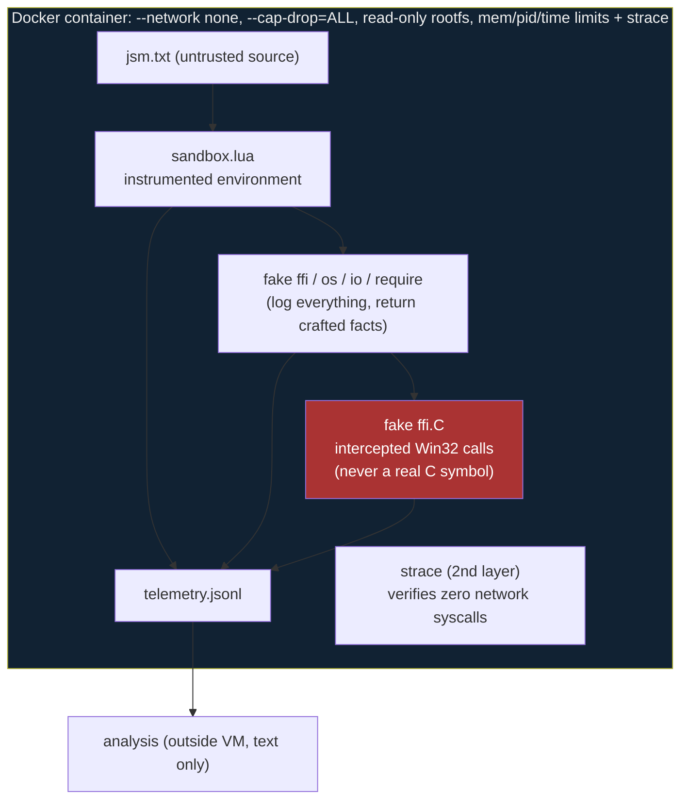
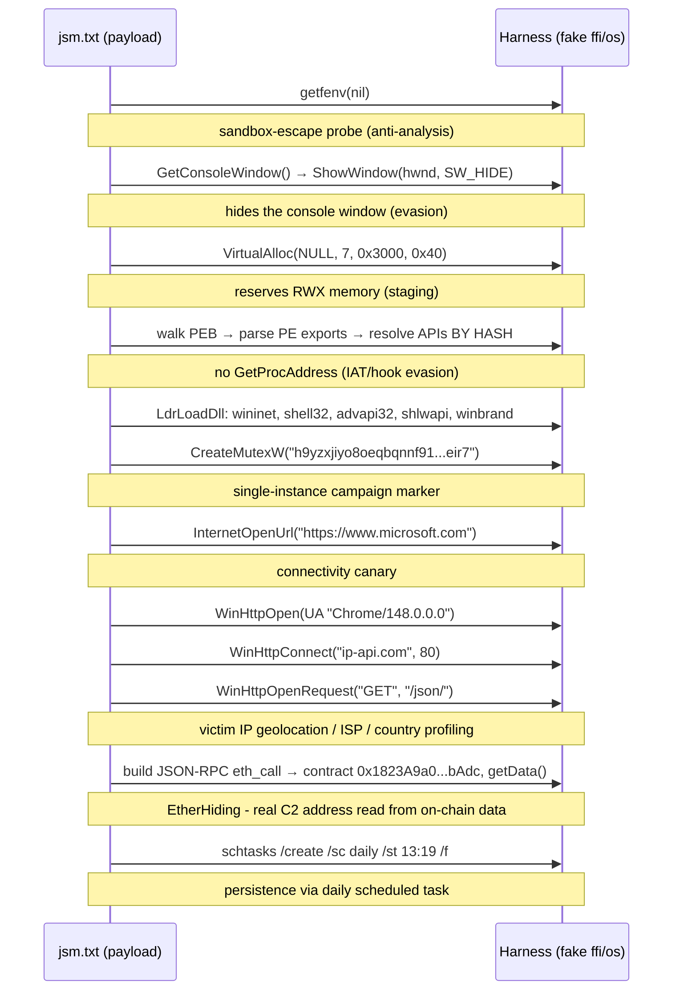

# Defensive Analysis: Lua-based Trojan Distributed via Cloned Repository

> ℹ️ This project was renamed from `gvm-rs` to `gvsn` in August 2026. This report predates the
> rename and correctly refers to the project under its former name throughout.

> **Case:** `Foremost-headsail607/gvm-rs` (malicious clone of `jhonsferg/gvm-rs`)
> **Classification:** Lua-script-loader trojan, consistent with the `Lua/Agent.CQ` family and the
> 2026 "SmartLoader → StealC" fake-repository campaign
> **Audience:** GitHub Trust & Safety, security researchers, and anyone hardening their own project
> against the same technique
> **Companion documents:**
> [`2026-06-malicious-clone-foremost-headsail607.md`](../security/incidents/2026-06-malicious-clone-foremost-headsail607.md)
> (timeline + static analysis) and this repository's `SECURITY.md`.

This document consolidates everything learned about the payload distributed by the malicious clone,
combining the earlier **static** analysis with a new **dynamic/behavioral** analysis performed with a
purpose-built instrumented LuaJIT harness. Its goal is twofold: (1) give GitHub Trust & Safety
concrete behavioral evidence - not just file hashes - so the malicious repository is acted on, and
(2) document the technique end-to-end so other maintainers can recognize and defend against it.

---

## 1. Executive summary

A cloned repository distributes a Windows payload through a four-stage loader chain that ends in a
heavily obfuscated **Lua** script interpreted by a renamed, *legitimate* LuaJIT runtime. The use of a
trusted scripting engine under an innocuous name (`minify.exe`) is a
[LOLBIN](https://lolbas-project.github.io/)-style evasion: the malicious logic never appears in the
`.exe`, only in the script it interprets.

Dynamic analysis inside a network-isolated instrumented harness recovered the payload's full
behavioral chain and its **network indicators**:

- **Victim profiling:** `WinHttpConnect("ip-api.com", 80)` + `GET /json/` (victim IP geolocation/ISP),
  under a spoofed Chrome `148.0.0.0` User-Agent, after an `https://www.microsoft.com` connectivity
  canary.
- **Blockchain-based C2 (EtherHiding):** a JSON-RPC `eth_call` invoking **`getData()`** (selector
  `0x3bc5de30`) on contract `0x1823A9a0Ec8e0C25dD957D0841e3D41a4474bAdc` - the real C2 address is
  read from on-chain data, a takedown-resistant dead-drop technique.
- **Persistence:** `schtasks /create /sc daily /st 13:19 /f` (scheduled task, daily at 13:19).
- **Campaign mutex:** `h9yzxjiyo8oeqbqnnf91vnrynkkvzvxq7ce7tg5ca779mq2zww8qdccogaagypk74mz6m6jbthtlsvzojd8ixzbn7eir7`.
- **Loader tradecraft:** console hiding, RWX memory allocation, PEB walking, and **API resolution by
  hash** (no `GetProcAddress`), dynamically loading `wininet.dll`, `shell32.dll`, `advapi32.dll`,
  `shlwapi.dll`, and `winbrand.dll`.

This is consistent with the `Lua/Agent.CQ` detection (ESET) and the 2026 "SmartLoader → StealC"
fake-repository campaign: a Lua-delivered stager for the StealC infostealer.

---

## 2. The delivery chain

The malicious repository's README links directly to a zip committed in `src/` (bypassing GitHub
Releases entirely). The zip contains four files; all SHA-256 hashes match the artifacts first seen in
the June commit history, confirming this is the *same* known payload, still actively distributed.

| File | Size | Role |
|---|---|---|
| `Launcher.bat` | 24 B | One-liner: `start minify.exe jsm.txt` |
| `minify.exe` | 31,920 B | **Genuine, unmodified LuaJIT 2.1 interpreter, renamed** (LOLBIN) |
| `lua51.dll` | 601,461 B | The Lua 5.1 runtime loaded by the interpreter |
| `jsm.txt` | 327,648 B | **The actual payload**: obfuscated Lua *source* (not bytecode) |

```mermaid
flowchart LR
    A["README download button<br/>(raw.githubusercontent.com link)"] --> B["gvm-rs-xiphisternal.zip"]
    B --> C["Launcher.bat<br/>'start minify.exe jsm.txt'"]
    C --> D["minify.exe<br/>= renamed LuaJIT 2.1 (LOLBIN)"]
    D --> E["lua51.dll<br/>Lua 5.1 runtime"]
    E --> F["jsm.txt<br/>obfuscated Lua payload"]
    F --> G["behavioral stage:<br/>anti-analysis + API-by-hash loader"]
    G --> H["network stage:<br/>ip-api.com profiling +<br/>EtherHiding C2 (eth_call getData)"]
    H -.->|"real C2 address read on-chain"| I["StealC second stage"]
    style F fill:#8b0000,color:#fff
    style G fill:#a33,color:#fff
    style H fill:#a33,color:#fff
    style I fill:#555,color:#fff,stroke-dasharray: 5 5
```

**Why this evades naive detection:** every legitimate `gvm-rs` binary is built and published only via
this repository's own `release.yml` pipeline with checksums and a VirusTotal scan. The clone has zero
releases and points its "download" button at a source-tree zip - no provenance, no scan, no signature.

---

## 3. Obfuscation (why static analysis alone stalls)

`jsm.txt` is 327,648 bytes of Lua source wrapped in control-flow-flattening / virtualization-style
obfuscation:

- Single/double-letter identifiers throughout.
- **Arithmetic-obfuscated constants** in place of literals, e.g. `321916+((-253077-38487)+-30351)`.
- A large **dispatch loop keyed on those constants** (a custom VM), so there is no linear
  "read the strings" path.
- Crucially, **any IOC strings (URLs, C2 hosts) are reconstructed only at runtime** - they are never
  present as plaintext. A best-effort static search for `http(s)://`, IPv4 literals, and Discord
  webhook paths found **none** (documented in §B of the incident report). This is precisely why a
  dynamic harness was necessary.

---

## 4. Dynamic analysis methodology (defense in depth)

Running the real `minify.exe` was never an option: it is a Windows PE and the analysis VM is Linux
with no Wine, so it could not have executed even by accident. Instead, only the Lua *source* was run
inside a **stock LuaJIT interpreter we control**, with every dangerous surface replaced by a fake that
logs the call and returns a fabricated answer.

Key safety properties of the harness (`~/lab/tools/luajit-harness/sandbox.lua`):

- **`ffi.C.*` never resolves to a real C function.** A pure-Lua metatable intercepts every declared
  symbol, so the script cannot touch real memory, syscalls, or sockets regardless of how many
  pointer casts it builds.
- **`ffi.cast` to any *function-pointer* type returns an inert Lua stub**, never executable code.
  This was the single most important control: the loader's core technique is to call a function
  pointer it computed via export-hash resolution, and without this stub the harness would have jumped
  into attacker-controlled native code.
- **`getfenv`/`setfenv`/`_ENV` are total replacements** that always return the sandboxed table and log
  a `sandbox_escape_probe` - real `getfenv(0)` in Lua 5.1 returns the *real* global table and would
  have leaked `os.execute`.
- The container provides a second, independent verification layer: `strace` showed **zero**
  network-family syscalls (`socket|connect|sendto|recvfrom`) across every run, confirming nothing
  escaped the Lua-level sandbox.

---

## 5. Observed behavior (dynamic evidence)

The following sequence was observed **deterministically across runs**, reconstructed verbatim from
`telemetry-2026-08-22.jsonl` (48,216 events). It is the payload's true behavior, not speculation.

### 5.1 Behavior-by-behavior significance

| Observed call | What it means | Why it matters |
|---|---|---|
| `getfenv(nil)` | Attempts to grab the real global environment | Classic Lua sandbox-escape / anti-analysis probe |
| `GetConsoleWindow` + `ShowWindow(hwnd, 0)` | Hides the console window | Evasion: runs invisibly for the logged-in user |
| `VirtualAlloc(..., PAGE_EXECUTE_READWRITE)` | Allocates **RWX** memory | Staging area for shellcode / a decrypted second stage |
| function-pointer call → PEB, then export-table walk | Resolves Win32 APIs **by hash** | Defeats import-table inspection and IAT hooks |
| `LdrLoadDll`: wininet, shell32, advapi32, shlwapi, winbrand | Pulls in networking, shell execution, registry/crypto, path utils, Windows branding | Capability set of an infostealer stager |
| `CreateMutexW("h9yzxjiyo8...eir7")` | 80-char single-instance mutex | Stable campaign identifier (IOC) |
| `InternetOpenUrl("https://www.microsoft.com")` | Connectivity canary | Gates execution on live internet access |
| `WinHttpConnect("ip-api.com", 80)` + `GET /json/` | Victim IP geolocation/ISP/country lookup | Victim profiling; common in stealers to filter by region |
| JSON-RPC `eth_call` → `getData()` @ `0x1823A9a0...bAdc` | Reads C2 config from **on-chain contract data** | **EtherHiding**: takedown-resistant C2 dead-drop |
| `schtasks /create /sc daily /st 13:19 /f` | Creates a daily scheduled task at 13:19 | **Persistence** across reboots |
| UA string `Chrome/148.0.0.0` | Spoofed browser User-Agent | Blends C2 traffic with normal browsing |

### 5.2 Assessment

This is a full infostealer **stager** chain, not just a loader skeleton: profile the victim, check
connectivity, resolve the real C2 from a blockchain dead-drop (EtherHiding), persist via scheduled
task, and stage RWX memory for the second stage. Combined with (a) the ESET `Lua/Agent.CQ` detection
on a file pulled from this repo's `raw.githubusercontent.com` link and (b) the external 2026
"SmartLoader → StealC" campaign context, the evidence supports classifying this as a Lua-delivered
**StealC** chain with EtherHiding C2 resolution.

---

## 6. Limitations (stated honestly)

- **The final C2 destination was not observed directly.** The payload resolves it by calling
  `getData()` on an Ethereum contract via JSON-RPC. A stateful fake-network harness answered with a
  decoy body; the payload **validated and rejected it**, then aborted cleanly on an internal nil -
  confirming the `eth_call` is the C2-resolution step and that it is guarded against generic fake
  responses (additional anti-analysis). The contract address and selector remain hard IOCs.
- **The contract carries no on-chain code right now.** `eth_getCode` against Ethereum mainnet, BSC,
  Polygon, Arbitrum One, Optimism, Base, Avalanche, Gnosis, and Sepolia all returned 0 bytes, and
  Etherscan shows no transactions. This indicates a **pre-positioned dead-drop**: the operator
  deploys the contract holding the live C2 only when the campaign activates (and may self-destruct it
  afterward), so the address is not "hot" or indexed while the malware is dormant. There is therefore
  no chain to pin down today; the address + selector stay valid as forward-looking detection IOCs.
- **The harness observes the Lua layer, not the native binary.** `minify.exe`'s own imports/registry/
  PE behavior is out of scope; analyzing it dynamically would require a dedicated isolated Windows VM.
- These are scope boundaries, not exonerations: the observed behavior (§5) is itself sufficient to
  classify the artifact as malicious.

---

## 7. Indicators of compromise (IOCs)

### 7.1 Confirmed (static + dynamic)

| Type | Indicator |
|---|---|
| SHA-256 (zip) | `396cd3da28dfd0ef477c87568329c845f7de2c6c4815c80d4e921b3c49500cda` |
| SHA-256 (`jsm.txt`) | `8f4b2dfd27ef330c184377cd9d01aef278f82d04f2598dafe1f373119043e56c` |
| SHA-256 (`minify.exe`) | `7ad4b911d05a12f91ab27ba3baa351a56653ca099dda7ad87ee2b94f8cd018c9` |
| SHA-256 (`lua51.dll`) | `04d3c82782927330d56827ff551697666dbab4b3abf5b86bde492efdd142bc58` |
| SHA-256 (`Launcher.bat`) | `bcf741a9c9411344965f8e451e364b8923ff1f00e375f61aa5419ee07618856c` |
| AV detection | `Lua/Agent.CQ` (ESET); StealC per Kaspersky + 12 engines (VirusTotal) |
| Malicious repo | `github.com/Foremost-headsail607/gvm-rs` |
| Distribution URL | `.../raw/refs/heads/main/src/gvm-rs-xiphisternal.zip` |

### 7.2 Network IOCs (recovered dynamically)

| Type | Indicator | Context |
|---|---|---|
| Domain | `ip-api.com` (port 80, `GET /json/`) | Victim IP geolocation/ISP profiling |
| URL | `https://www.microsoft.com` | Connectivity canary |
| Ethereum contract | `0x1823A9a0Ec8e0C25dD957D0841e3D41a4474bAdc` | EtherHiding C2 dead-drop; called via JSON-RPC `eth_call` |
| Function selector | `0x3bc5de30` = `getData()` | Reads the C2 config from on-chain data |
| User-Agent | `Mozilla/5.0 (Windows NT 10.0; Win64; x64) AppleWebKit/537.36 (KHTML, like Gecko) Chrome/148.0.0.0 Safari/537.36` | Spoofed browser UA for C2 traffic |

### 7.3 Host-based IOCs (recovered dynamically)

| Type | Indicator |
|---|---|
| Mutex | `h9yzxjiyo8oeqbqnnf91vnrynkkvzvxq7ce7tg5ca779mq2zww8qdccogaagypk74mz6m6jbthtlsvzojd8ixzbn7eir7` |
| Persistence | `schtasks /create /sc daily /st 13:19 /f` (daily scheduled task at 13:19) |
| Dynamically loaded DLLs | `wininet.dll`, `shell32.dll`, `advapi32.dll`, `shlwapi.dll`, `winbrand.dll` |
| Loader chain | `Launcher.bat → minify.exe (renamed LuaJIT) → lua51.dll → jsm.txt` |

### 7.4 Behavioral IOCs

- Console-window hiding via `GetConsoleWindow` + `ShowWindow(_, SW_HIDE)`.
- RWX memory allocation (`VirtualAlloc` with `PAGE_EXECUTE_READWRITE`).
- PEB walking + `IMAGE_EXPORT_DIRECTORY` enumeration for **API-by-hash** (no `GetProcAddress`).
- `getfenv` sandbox-escape probing.
- Runtime string reconstruction (no plaintext IOCs in the static file; all built at runtime).

### 7.5 Not recovered

- The final decoded C2 destination (behind the `getData()` contract call - the payload rejected a
  decoy response, confirming it validates the result; see §6).
- The on-chain C2 content: the contract currently holds **no code** on any major EVM chain
  (pre-positioned dead-drop; see §6).
- The RPC endpoint the payload would use for the `eth_call`.

---

## 8. Detection & defense guidance (for other maintainers)

This technique generalizes beyond this one repository. To defend your own project and users:

1. **Watch for clones that distribute source-tree binaries.** A legitimate project ships binaries via
   GitHub Releases with checksums; a clone whose README points a "download" button at a `raw` zip in
   `src/` has no provenance. (This repository's `clone-watch` pipeline caught exactly this -
   see `.github/scripts/clone-deep-scan.sh`.)
2. **Treat renamed scripting engines as a red flag.** A `.exe` that is byte-identical to a stock
   interpreter (LuaJIT, Python, Node) plus a "data" script it interprets is a LOLBIN pattern. Check
   PE imports: a genuine LuaJIT imports only `lua51.dll` + CRT - the malicious logic is in the script.
3. **Flag the behavioral triad** in any sandbox/EDR: *console hiding* + *RWX allocation* +
   *PEB/export walking* together are highly specific to reflective loaders, regardless of language.
4. **Don't rely on static string IOCs for VM-obfuscated scripts.** If strings are rebuilt at runtime,
   you need a sandbox with full API instrumentation (like the harness described in §4) to see them.

---

## 9. Evidence inventory

| Artifact | Location | Notes |
|---|---|---|
| Dynamic telemetry | `security/telemetry-2026-08-22.jsonl` | 48,216 events; JSONL, one event/line |
| Harvested strings | `security/telemetry-2026-08-22.strings.txt` | 214 runtime-reconstructed strings (incl. all IOCs) |
| OS-level trace | `security/strace-2026-08-22.log` | Confirms zero network syscalls |
| Harness source | `~/lab/tools/luajit-harness/sandbox.lua` (VM) | Instrumented fake-Win32 LuaJIT sandbox |
| Harness build/iteration log | `security/harness-buildlog-2026-08-22.md` | Every fix and why (3 sessions) |
| Static analysis + timeline | `docs/security/incidents/2026-06-malicious-clone-foremost-headsail607.md` | §A commits, §B payload, §C dynamic |
| Hashes | `security/incident-2026-06-gvm-rs-clone.md` | 5 SHA-256 values |

---

*Prepared for defensive purposes. All dynamic analysis was performed inside a network-isolated
container; the original Windows binary was never executed, and no untrusted code ran outside the
sandbox.*
